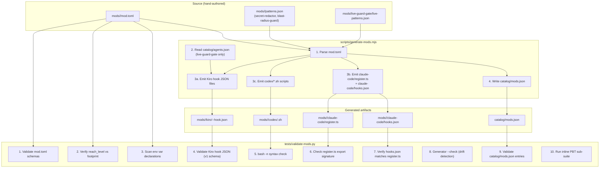
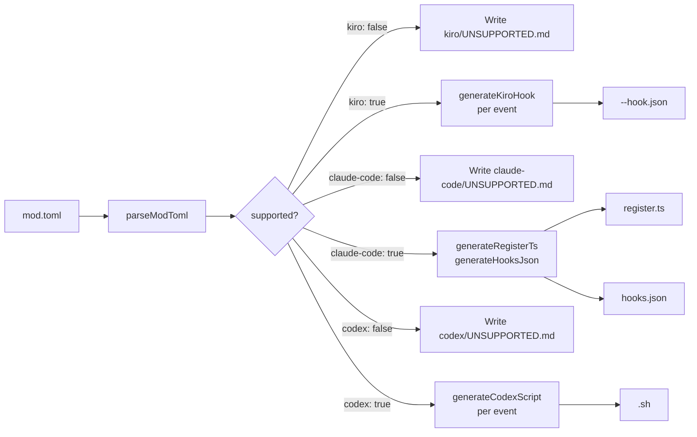

# Design Document: `cross-harness-mods`

## Overview

The `cross-harness-mods` feature introduces a first-class behavioral extension layer to
`vanguard-frontier-agentic`. A **mod** is a named package that ships harness-native
implementations for Claude Code, Kiro, and Codex from a single harness-agnostic
`mod.toml` manifest. Five enterprise starter mods are included: `secret-redactor`,
`blast-radius-guard`, `live-guard-gate`, `context-burn`, and `audit-trail`.

The design follows the established generator pattern used by `generate-kiro-powers.mjs`
and the gate pattern used by `validate-catalog.py`: a single Node.js script reads source
manifests and writes all derived files; a Python gate validates them deterministically;
the whole suite joins `npm run validate`.

### Core tension: harness asymmetry

Claude Code exposes an in-process TypeScript SDK with full event-handler semantics.
Kiro hooks are out-of-process JSON-configured shell commands that receive context on
stdin and respond by exit code and stdout. Codex hooks are POSIX shell scripts registered
externally. The design centers on making this asymmetry explicit in `mod.toml` rather
than hiding it — each harness declares `supported = true/false` per mod, and the
generator produces the correct artifact type for each harness rather than trying to
unify them into a shared runtime.

---

## Architecture



---

## Components and Interfaces

### 1. `mod.toml` — harness-agnostic manifest

The single source of truth per mod. The generator reads it; the validator checks it.
It never describes how to implement behavior — only what behavior the mod provides.

#### Why pure Node.js string generation, not a template engine?

The generator uses pure Node.js string interpolation (template literals), matching
`generate-kiro-powers.mjs` exactly. A template engine like Handlebars or EJS would add:
- A dev dependency (violates the repo's dependency discipline)
- A compilation/pre-processing step
- A second syntax to learn and maintain

The generated artifacts are small and structured. All four output types (JSON, TypeScript,
shell) have straightforward shape. Pure string templates are deterministic, zero-dep, and
already proven at scale in this repo.

---

### 2. Generator — `scripts/generate-mods.mjs`

Mirrors the structure of `generate-kiro-powers.mjs`:

```
1. readAllMods()          → parse every mods/*/mod.toml via @iarna/toml (zero-dep fallback: JSON5)
   NOTE: Node 22.x includes a native TOML parser behind a flag; for now use a
   minimal bundled TOML parser to stay zero-dep. Alternatively, mod.toml files are
   simple enough to parse with a hand-rolled 50-line regex parser since the schema
   is fixed. See §Data Models for the exact TOML subset used.

2. readCatalog()          → read catalog/agents.json (needed by live-guard-gate)

3. for each mod:
   generateKiroArtifacts()    → write mods/<id>/kiro/<id>-<event>-hook.json
   generateClaudeCodeArtifacts() → write mods/<id>/claude-code/register.ts
                                 → write mods/<id>/claude-code/hooks.json
   generateCodexArtifacts()   → write mods/<id>/codex/<event>.sh

4. generateCatalog()      → write catalog/mods.json

5. exit 0, print "Generated <N> mods for <M> harnesses"
```

**`--check` mode**: instead of writing, compare on-disk content against the generated
string; collect mismatches; exit 1 with paths if any, exit 0 otherwise. Matches
`generate-kiro-powers.mjs` `--check` behavior exactly.

**TOML parsing**: Node 22 has `--experimental-strip-types` but no built-in TOML parser
in the stable API as of 2025. The generator will include a minimal self-contained TOML
parser that handles the exact subset of TOML used by `mod.toml` (tables, arrays of
strings, booleans, integers, quoted strings). No external dependency. If the project
later adds `@toml-tools/parser` or similar to `devDependencies`, the internal parser can
be swapped out. Python's `tomllib` (stdlib since 3.11) is used by the validator.

---

### 3. Validation gate — `tests/validate-mods.py`

Structured after `validate-catalog.py`:

```python
def main() -> int:
    errors: list[str] = []

    if not mods_dir_exists():
        print("FAIL [mods] mods/ directory is missing")
        return 1

    mods = discover_mods()
    for mod in mods:
        errors += validate_toml_schema(mod)
        errors += validate_reach_level(mod)
        errors += validate_env_reads(mod)
        errors += validate_kiro_hooks(mod)
        errors += validate_codex_scripts(mod)
        errors += validate_claude_code(mod)

    errors += validate_generator_check()    # invokes: node scripts/generate-mods.mjs --check
    errors += validate_catalog_mods_json()
    errors += run_pbt_suite()              # inline fast-check-equivalent using stdlib re

    if errors:
        for e in errors:
            print(f"FAIL [mods] {e}")
        return 1

    print(f"OK: <N> mods valid (kiro: <K>, claude-code: <C>, codex: <X>)")
    return 0
```

Each `validate_*` function collects and returns error strings rather than raising, so all
failures are visible in one run. This matches the `validate-catalog.py` pattern.

---

### 4. Kiro hook protocol

Kiro executes hook commands as child processes. The protocol:

```
stdin  → JSON object (tool call context)
stdout → optional JSON response
stderr → error/log messages
exit 0 → success (with or without stdout)
exit 2 → block this tool call
exit N → silent failure, hook is skipped
```

**stdin schema** (what Kiro sends to a PreToolUse command hook):

```json
{
  "session_id": "string",
  "tool_name": "string",
  "tool_input": { /* tool-specific arguments object */ }
}
```

For PostToolUse, stdin also includes:

```json
{
  "session_id": "string",
  "tool_name": "string",
  "tool_input": { /* arguments */ },
  "tool_output": { /* result */ }
}
```

**Three response patterns**:

```
Pattern A: Pass-through
  exit 0, no stdout
  → Kiro proceeds with the original tool call unmodified

Pattern B: Block
  exit 2
  stderr: "human-readable reason"
  → Kiro aborts the tool call, shows reason to user

Pattern C: Confirm (ask user)
  exit 0
  stdout: {"hookSpecificOutput":{"permissionDecision":"ask","permissionDecisionReason":"..."}}
  → Kiro prompts user for explicit confirmation before proceeding

Pattern D: Modify (mutate arguments — used by secret-redactor)
  exit 0
  stdout: { /* complete modified tool_input object */ }
  → Kiro replaces the tool arguments with the modified object
```

**Hook file naming convention** (deterministic ordering for composability):

```
mods/<mod-id>/kiro/<mod-id>-<event-lowercase>-hook.json
```

Examples:
```
mods/secret-redactor/kiro/secret-redactor-pretooluse-hook.json
mods/blast-radius-guard/kiro/blast-radius-guard-pretooluse-hook.json
mods/audit-trail/kiro/audit-trail-posttooluse-hook.json
```

When multiple mods are installed to `.kiro/hooks/`, Kiro processes hook files in
alphabetical order of filename. The `<mod-id>-` prefix ensures each mod's hooks sort
together and that ordering between mods is deterministic and documentable.

---

### 5. Claude Code mod interface

```typescript
// Types referenced by all register.ts files
export interface ModEventEmitter {
  (event: "PreToolUse", handler: PreToolUseHandler): void;
  (event: "PostToolUse", handler: PostToolUseHandler): void;
  (event: "SessionStart", handler: SessionStartHandler): void;
  (event: "Stop", handler: StopHandler): void;
}

export interface ModOptions {
  [key: string]: unknown;
}

export type PreToolUseHandler = (ctx: PreToolUseContext) =>
  | void
  | { deny: string }
  | { ask: true; reason: string }
  | { modified: Record<string, unknown> };

export interface PreToolUseContext {
  session_id: string;
  tool_name: string;
  tool_input: Record<string, unknown>;
}

export interface PostToolUseContext {
  session_id: string;
  tool_name: string;
  tool_input: Record<string, unknown>;
  tool_output: unknown;
}

// Every register.ts exports this exact signature
export default function register(on: ModEventEmitter, options: ModOptions): void;
```

The `hooks.json` companion file (for static analysis tooling):

```json
{
  "mod_id": "secret-redactor",
  "events": ["PreToolUse", "PostToolUse"]
}
```

The validator checks that every event string in `hooks.json` appears as a call site
`on("<EventName>"` in `register.ts` via regex, and vice versa.

---

### 6. Generator pipeline (detailed)



---

## Data Models

### `mod.toml` complete schema

```toml
# ─── Identity ────────────────────────────────────────────────────────────────
[mod]
id          = "secret-redactor"          # kebab-case; ^[a-z0-9][a-z0-9-]+$
name        = "Secret Redactor"          # human display name
description = "Scans tool inputs and outputs for credential-shaped strings and replaces them with [REDACTED]."
version     = "0.1.0"                    # semver MAJOR.MINOR.PATCH
reach_level = 0                          # integer 0–3 (see taxonomy below)
events      = ["PreToolUse", "PostToolUse"]  # subset of supported Kiro/Claude Code events

# ─── Environmental footprint ─────────────────────────────────────────────────
[footprint]
env_reads   = ["VANGUARD_SECRET_REDACTOR_PATTERNS"]  # every $VAR the mod reads
file_writes = []                         # every path/glob the mod writes to
spawns      = []                         # subprocesses started by the mod
egress_hosts = []                        # outbound network destinations

# ─── Per-harness capability flags ────────────────────────────────────────────
[harnesses.claude-code]
supported = true

[harnesses.kiro]
supported = true

[harnesses.codex]
supported = true

# Optional: per-harness options
[harnesses.claude-code.options]
# mod-specific config keys consumed by register.ts
# Example for context-burn:
# max_tokens = 200000

# Optional: per-harness dependency declarations (Codex only)
# [harnesses.codex]
# requires = ["jq"]  # external commands the .sh script uses
```

**Reach level taxonomy** (encoded in `mod.toml` as `reach_level`):

| Level | Footprint | Examples |
|-------|-----------|---------|
| L0 | In-process / in-memory only | `secret-redactor` (regex scan, no I/O) |
| L1 | Reads/writes local files or env vars | `context-burn`, `audit-trail`, `blast-radius-guard` |
| L2 | Spawns subprocesses or agent processes | `live-guard-gate` (conservatively, for future subprocess) |
| L3 | Initiates outbound network I/O | (none in starter set) |

**Reach level derivation rule** (enforced by `validate:mods`):

```
if len(egress_hosts) > 0:  reach_level = 3
elif len(spawns) > 0:      reach_level = 2
elif len(file_writes) > 0: reach_level = 1
else:                       reach_level = 0
```

---

### `catalog/mods.json` entry schema

```json
{
  "$schema": "https://json-schema.org/draft/2020-12/schema",
  "title": "Mod Catalog Entry",
  "type": "object",
  "required": ["id", "name", "version", "description", "reach_level", "events", "harnesses", "path"],
  "properties": {
    "id":          { "type": "string", "pattern": "^[a-z0-9][a-z0-9-]+$" },
    "name":        { "type": "string", "minLength": 1 },
    "version":     { "type": "string", "pattern": "^\\d+\\.\\d+\\.\\d+$" },
    "description": { "type": "string", "minLength": 10 },
    "reach_level": { "type": "integer", "minimum": 0, "maximum": 3 },
    "events":      { "type": "array", "minItems": 1, "items": { "type": "string" } },
    "harnesses":   { "type": "array", "minItems": 1, "items": {
                       "enum": ["claude-code", "kiro", "codex"] } },
    "path":        { "type": "string", "description": "repo-relative path to mod directory" },
    "security_notes": { "type": "string" }
  },
  "additionalProperties": true
}
```

Concrete example for `secret-redactor`:

```json
{
  "id": "secret-redactor",
  "name": "Secret Redactor",
  "version": "0.1.0",
  "description": "Scans tool inputs and outputs for credential-shaped strings and replaces them with [REDACTED:<pattern-name>].",
  "reach_level": 0,
  "events": ["PreToolUse", "PostToolUse"],
  "harnesses": ["claude-code", "kiro", "codex"],
  "path": "mods/secret-redactor",
  "security_notes": "L0 in-process. Patterns are regex-only; no external calls. Extensible via VANGUARD_SECRET_REDACTOR_PATTERNS env var pointing to additional patterns.json."
}
```

---

### Pattern catalog schema (`patterns.json`)

Used by `secret-redactor` and `blast-radius-guard`. Shared format for extensibility.

```json
[
  {
    "id": "aws-access-key",
    "name": "AWS Access Key",
    "description": "AWS IAM access key ID starting with AKIA",
    "regex": "AKIA[0-9A-Z]{16}",
    "severity": "critical",
    "context": ["all"]
  },
  {
    "id": "github-pat",
    "name": "GitHub Personal Access Token",
    "description": "GitHub fine-grained or classic PAT",
    "regex": "(ghp|gho|ghu|ghs|ghr)_[A-Za-z0-9]{36,255}",
    "severity": "critical",
    "context": ["all"]
  }
]
```

**Schema fields**:

| Field | Type | Description |
|-------|------|-------------|
| `id` | string | kebab-case unique identifier |
| `name` | string | human display name |
| `description` | string | what credential type this matches |
| `regex` | string | POSIX-compatible regex (works in Python `re`, bash `grep -E`, and TypeScript `RegExp`) |
| `severity` | `"critical" \| "high" \| "medium" \| "low"` | impact if leaked |
| `context` | string[] | tool types this applies to: `"all"`, `"bash"`, `"file-write"`, `"read-file"` |

The `context` field allows `blast-radius-guard` to skip scanning file content for command
injection patterns that only apply to shell execution. `secret-redactor` uses `"all"`.

**Extensibility**: when `VANGUARD_SECRET_REDACTOR_PATTERNS` (or
`VANGUARD_BLAST_RADIUS_PATTERNS`) is set to a file path, the implementation loads that
file as a JSON array with the same schema and concatenates it with the built-in list.
Pattern IDs must be unique across built-in and extension sets; duplicates are a logged
warning, not a hard failure.

---

### Audit log entry schema (`audit-trail`)

One JSONL line per tool call. PCI-DSS motivated: we hash args and results rather than
store them in plaintext to avoid the log becoming a card-data store.

```json
{
  "timestamp":       "2025-07-15T14:32:01.234Z",
  "session_id":      "pid-12345-1752584321",
  "agent_id":        "claude-code",
  "tool_name":       "bash",
  "args_hash":       "sha256:a3f9c2...e4b1",
  "result_hash":     "sha256:7d1e0f...c9a2",
  "sequence_number": 1
}
```

**Field definitions**:

| Field | Type | Notes |
|-------|------|-------|
| `timestamp` | ISO 8601 with ms | `date -u +%Y-%m-%dT%H:%M:%S.%3NZ` in bash; `new Date().toISOString()` in TS |
| `session_id` | string | From `VANGUARD_AUDIT_SESSION_ID` env; fallback: `sha256(pid + start_time)[:12]` |
| `agent_id` | string | From `VANGUARD_AUDIT_AGENT_ID` env; fallback: `"unknown"` |
| `tool_name` | string | Tool name from hook context |
| `args_hash` | string | `"sha256:" + sha256(JSON.stringify(tool_input))` |
| `result_hash` | string | `"sha256:" + sha256(JSON.stringify(tool_output))` |
| `sequence_number` | integer | 1-based monotonic counter per session; derived from line count of existing log file + 1 |

The `sequence_number` is derived at append time by counting existing lines in the log
file (POSIX: `wc -l`). This is racy only if two sessions write to the same file
simultaneously — acceptable since the filename includes the date and sessions are expected
to be single-user. The design does not require strict ordering guarantees across sessions.

---

### Burn status file schema (`context-burn`)

```json
{
  "session_id":    "pid-12345-1752584321",
  "tool_call_count": 47,
  "last_updated":  "2025-07-15T14:32:01.234Z",
  "threshold_events": [
    {
      "threshold_pct": 70,
      "tokens_at_event": 140000,
      "max_tokens": 200000,
      "timestamp": "2025-07-15T14:28:10.000Z"
    }
  ]
}
```

---

### Directory layout for a single mod

```
mods/
└── secret-redactor/
    ├── mod.toml                        ← hand-authored manifest (source of truth)
    ├── patterns.json                   ← hand-authored pattern catalog
    ├── README.md                       ← hand-authored per-mod documentation
    ├── claude-code/
    │   ├── register.ts                 ← GENERATED by generate-mods.mjs
    │   └── hooks.json                  ← GENERATED by generate-mods.mjs
    ├── kiro/
    │   ├── secret-redactor-pretooluse-hook.json    ← GENERATED
    │   └── secret-redactor-posttooluse-hook.json   ← GENERATED
    └── codex/
        ├── pretooluse.sh               ← GENERATED
        └── posttooluse.sh              ← GENERATED
```

For `live-guard-gate` (which requires reading catalog):

```
mods/
└── live-guard-gate/
    ├── mod.toml
    ├── live-patterns.json              ← hand-authored live-guard trigger patterns
    ├── live-agents.json                ← GENERATED from catalog/agents.json
    ├── README.md
    ├── claude-code/
    │   ├── register.ts
    │   └── hooks.json
    ├── kiro/
    │   └── live-guard-gate-pretooluse-hook.json
    └── codex/
        └── pretooluse.sh
```

---

## Correctness Properties

*A property is a characteristic or behavior that should hold true across all valid executions of a system — essentially, a formal statement about what the system should do. Properties serve as the bridge between human-readable specifications and machine-verifiable correctness guarantees.*

### Property 1: Redaction Completeness

*For any* string `s` and any pattern `p` in `secret-redactor`'s `patterns.json`, applying
the redaction function to `s` produces a string that contains zero matches of `p`'s
regex.

Formally: `re.search(p.regex, redact(s, p)) is None` for all `s`.

**Validates: Requirements 10.3, 10.4, 16.1**

---

### Property 2: Guard Blocking

*For any* command string `cmd` that matches at least one pattern `q` in
`blast-radius-guard`'s `patterns.json`, the guard evaluation function returns a
non-pass decision.

Formally: `evaluate(cmd).decision in {"block", "confirm"}` whenever
`any(re.search(q.regex, cmd) for q in patterns)`.

**Validates: Requirements 11.3, 11.4, 11.5, 16.2**

---

### Property 3: Audit Completeness

*For any* sequence of N tool-call event objects where N ∈ [1, 50], applying the
`audit-trail` log-append function to each event in sequence produces a JSONL string
containing exactly N lines, each parseable as valid JSON, with `sequence_number` values
1 through N in order.

Formally:
```
lines = parse_jsonl(log_after_n_appends)
len(lines) == N
lines[i]["sequence_number"] == i + 1  for all i in [0, N-1]
```

**Validates: Requirements 14.2, 14.3, 16.3**

---

### Property 4: Manifest Validity Round-Trip

*For any* valid `mod.toml` content object `t` (constructed from the fast-check arbitrary
matching the schema), the cycle `parse_toml(t) → extract_catalog_entry → JSON.stringify →
JSON.parse` produces an object with:
- `id`: string matching `^[a-z0-9][a-z0-9-]+$`
- `name`: non-empty string
- `version`: string matching `^\d+\.\d+\.\d+$`
- `reach_level`: integer in [0, 3]
- `events`: non-empty array of strings
- `harnesses`: non-empty array of strings

**Validates: Requirements 8.2, 16.4**

---

### Property 5: Generator Idempotency

*For any* `mod.toml` input `t`, running the generator's per-mod transformation function
twice on the same input produces byte-for-byte identical outputs on both runs.

Formally: `generate(t) == generate(generate(t))`

Equivalently: the generator is a pure function of `mod.toml` content with no ambient
state dependency (no wall clock, no random, no external reads).

**Validates: Requirements 6.7, 16.5**

---

### Property 6: Reach Level Derivation

*For any* combination of `footprint` arrays `{env_reads, file_writes, spawns, egress_hosts}`,
the computed reach level matches the deterministic formula:
`3 if egress_hosts else 2 if spawns else 1 if file_writes else 0`.

**Validates: Requirements 2.1, 2.2**

---

### Property 7: Environment Variable Declaration Coverage

*For any* shell script string containing at least one `$VAR` or `${VAR}` reference, the
env-scan function identifies every referenced variable name and returns a set containing
all of them.

Formally: for any script `s` and variable `v` appearing as `$v` or `${v}` in `s`,
`v in scan_env_vars(s)`.

**Validates: Requirements 2.3**

---

## Error Handling

### Generator error handling

```
TOML parse failure      → print error identifying file; continue processing remaining mods;
                          exit 1 after all mods are processed (never fail-fast mid-run)

Missing required field  → print which field; include file path; continue

Unsupported harness     → write UNSUPPORTED.md instead of implementation files; exit 0

catalog/agents.json     → if missing, emit error for live-guard-gate only; other mods unaffected
  read failure

File write failure      → print OS error with path; exit 1 immediately (I/O errors are non-recoverable)
```

### Validator error handling

All failures are collected before printing. Every error line begins `FAIL [mods]` followed
by file path and description. The gate exits 0 only when all checks pass and the summary
line is printed. This matches `validate-catalog.py`'s collect-and-report pattern.

### Kiro hook error handling

- Exit 2 with stderr message is the canonical block signal. The message is shown to the
  user by Kiro. Keep it under 200 characters for legibility.
- If stdin parsing fails (malformed JSON), the hook exits 1 (not 2). This avoids
  silently blocking a tool call because of a hook parsing bug. Exit 1 is treated by Kiro
  as a hook error, not a tool-call block.
- The `audit-trail` hook must not fail silently: if the log file cannot be opened or
  written, it exits 1 with an error on stderr. Fail-closed is the right default for an
  audit system — the alternative (exiting 0 and skipping the log) is worse.

### Claude Code error handling

The `register.ts` handler must never throw an unhandled exception — the Claude Code SDK
may not catch exceptions from mod handlers gracefully. All handlers are wrapped in
`try/catch`; on failure they log to `console.error` and return `void` (pass-through)
except for `audit-trail`, which returns a soft-error object if logging fails.

---

## Testing Strategy

### Unit tests (example-based)

- Generator produces correct Kiro hook JSON for a fixture `mod.toml` with each supported
  event type.
- Generator writes `UNSUPPORTED.md` and no implementation files when `supported = false`.
- Generator `--check` exits 1 when an on-disk file differs from generated content.
- Validator reports `FAIL [mods]` for a `mod.toml` missing required keys.
- Validator reports `FAIL [mods]` for a mismatched `reach_level`.
- `audit-trail` creates parent directories when log file path does not exist.
- `secret-redactor` pattern with no match exits 0 with no stdout.
- `blast-radius-guard` in `block` mode exits 2 for a `rm -rf /` command.

### Property-based tests

The five properties from Requirement 16 are implemented as follows:

**P1 + P2 (Redaction Completeness, Guard Blocking)** — inline in `tests/validate-mods.py`
using only `stdlib.re`. Generates adversarial strings by constructing synthetic strings
that contain the pattern regex literally, then verifying `redact(s)` leaves no match.
Also generates random non-matching strings and verifies pass-through.

```python
# Redaction completeness (illustrative excerpt)
import re, random, string

def test_redaction_completeness():
    pattern = {"id": "aws-access-key", "regex": r"AKIA[0-9A-Z]{16}"}
    suffix = ''.join(random.choices(string.ascii_uppercase + string.digits, k=16))
    s = f"key=AKIA{suffix}"
    result = redact(s, [pattern])
    assert re.search(pattern["regex"], result) is None, f"Pattern still present after redact: {result}"
```

Runs 200 iterations with randomly generated suffixes.

**P3 (Audit Completeness)**, **P4 (Manifest Validity Round-Trip)**, **P5 (Generator
Idempotency)** — in `tests/fuzz-properties.test.mjs` using the existing `fast-check`
devDependency. No new devDependencies added.

```javascript
// P3: Audit Completeness (illustrative)
import fc from "fast-check";

const toolCallEvent = fc.record({
  tool_name: fc.string({ minLength: 1, maxLength: 30 }),
  tool_input: fc.object(),
  tool_output: fc.oneof(fc.string(), fc.object(), fc.integer()),
});

fc.assert(
  fc.property(
    fc.array(toolCallEvent, { minLength: 1, maxLength: 50 }),
    (events) => {
      const log = events.reduce((acc, evt, i) => {
        const entry = buildLogEntry(evt, i + 1);
        return acc + JSON.stringify(entry) + "\n";
      }, "");
      const lines = log.trim().split("\n");
      assert.equal(lines.length, events.length);
      lines.forEach((line, i) => {
        const entry = JSON.parse(line);
        assert.equal(entry.sequence_number, i + 1);
      });
    }
  ),
  { numRuns: 200 }
);
```

**P6 (Reach Level Derivation)** and **P7 (Env Var Coverage)** — inline in
`tests/validate-mods.py` as property sub-tests using itertools and random sampling.

### Integration tests (gate-level)

`npm run validate:mods` is the integration test. With the five starter mods present, it
must complete in under 30 seconds and exit 0. The gate itself exercises every code path
that a unit test would hit via the generator `--check` sub-step.

The `validate:mods` gate does not run `bash -n` through the Node.js generator; it calls
`subprocess.run(["bash", "-n", script_path])` directly from Python. This is safe because
`bash -n` only checks syntax and never executes the script.

---

## Claude Code vs Kiro Capability Matrix

| Mod | Claude Code | Kiro | Codex | Notes |
|-----|------------|------|-------|-------|
| `secret-redactor` | ✅ Full in-process | ✅ Shell + JSON stdin/stdout | ✅ Shell | Modify pattern (Pattern D) is cleanest in Claude Code; Kiro writes modified JSON to stdout |
| `blast-radius-guard` | ✅ `{ ask: true }` or `{ deny }` | ✅ Exit 0 with ask JSON or exit 2 | ✅ Shell exit 2 | VANGUARD_BLAST_RADIUS_MODE controls block vs confirm |
| `live-guard-gate` | ✅ `{ ask: true, reason }` | ✅ Exit 0 with ask JSON | ✅ Shell exit 0 with message | No subprocess spawning — prompt only |
| `context-burn` | ✅ In-memory accumulator + console.warn | ⚠️ Partial — Kiro PostToolUse gets no token count; uses tool-call count as proxy | ✅ Shell, tool-call count only | Claude Code is the only harness with token counts |
| `audit-trail` | ✅ Synchronous append in handler | ✅ Receives result on stdin; appends before exit 0 | ✅ Shell, POSIX tools only | Kiro PostToolUse receives full tool output on stdin |

**Asymmetry notes**:

1. `context-burn` declares `supported = true` for Kiro but with reduced capability
   (tool-call count, not token count). The `mod.toml` documents this under
   `[harnesses.kiro]` with a `notes` key: `"Token count unavailable in Kiro hook context; tracks tool call count as a proxy."`.

2. `secret-redactor` uses Pattern D (argument modification) for Kiro. This requires the
   Kiro hook to read `tool_input` from stdin, apply regex replacements, and write the
   modified `tool_input` back to stdout. The hook must preserve the full JSON structure;
   only matched substrings within string values are replaced.

---

## Data Flow for Each Starter Mod

### `secret-redactor` data flow

```
Harness detects tool call
        │
        ▼
[PreToolUse hook fires]
   stdin: { session_id, tool_name, tool_input }
        │
        ▼
   Load patterns.json  ──── merge VANGUARD_SECRET_REDACTOR_PATTERNS (if set)
        │
        ▼
   for each pattern p:
     scan JSON.stringify(tool_input) for p.regex
        │
     ┌──┴──────────────────────────────┐
   match?                           no match
     │                                 │
     ▼                                 ▼
   replace match with            exit 0, no stdout
   [REDACTED:<pattern-id>]        (pass-through)
   log to stderr
     │
     ▼
   exit 0, write modified tool_input JSON to stdout
        │
        ▼
[PostToolUse hook fires — same logic applied to tool_output]
```

### `blast-radius-guard` data flow

```
[PreToolUse hook fires for Bash tool call]
   stdin: { session_id, tool_name: "bash", tool_input: { command: "..." } }
        │
        ▼
   Load patterns.json  ──── merge VANGUARD_BLAST_RADIUS_PATTERNS (if set)
        │
        ▼
   scan tool_input.command + tool_input.path (for file-write tools)
        │
     ┌──┴──────────────────────────────┐
   match?                           no match
     │                                 │
     ▼                                 ▼
   read VANGUARD_BLAST_RADIUS_MODE  exit 0, no stdout
     │
   ┌─┴──────────┐
  "block"    "confirm" (default)
     │            │
     ▼            ▼
  exit 2      exit 0, write ask JSON to stdout
  reason      {"hookSpecificOutput":{"permissionDecision":"ask",
  to stderr    "permissionDecisionReason":"<pattern match: rm-rf-root>"}}
```

### `live-guard-gate` data flow

```
[PreToolUse hook fires]
   stdin: { session_id, tool_name, tool_input }
        │
        ▼
   Load live-patterns.json (generated from catalog/agents.json at mods:write time)
        │
        ▼
   extract target: tool_input.command | tool_input.path | tool_input.resource
        │
        ▼
   match target against live-patterns
        │
     ┌──┴──────────────────────────────┐
   match?                           no match
     │                                 │
     ▼                                 ▼
   identify matching live-guard    exit 0, no stdout
   agent from live-agents.json
     │
     ▼
   exit 0, write ask JSON:
   {"hookSpecificOutput":{"permissionDecision":"ask",
    "permissionDecisionReason":"This operation matches live-guard agent
     <agent-id>. Invoke that agent for approval before proceeding."}}
```

### `context-burn` data flow (Claude Code — most capable harness)

```
[SessionStart → register handler called]
   initialize: tokenAccumulator = 0, max = options.max_tokens ?? 200_000
        │
        ▼
[PostToolUse event fires for each tool call]
   estimate token delta from tool_input + tool_output size
        │
        ▼
   tokenAccumulator += delta
        │
        ▼
   if tokenAccumulator / max >= 0.90:
     console.warn("[context-burn] CRITICAL: 90% context used ...")
   elif tokenAccumulator / max >= 0.70:
     console.warn("[context-burn] WARNING: 70% context used ...")
        │
        ▼
   return void (never blocks)

[Kiro/Codex variant — uses tool-call count as proxy]
   read Burn_Status_File (JSON)
   increment tool_call_count
   write updated Burn_Status_File
   emit warning to stderr if count crosses configurable thresholds
```

### `audit-trail` data flow

```
[PostToolUse hook fires]
   stdin: { session_id, tool_name, tool_input, tool_output }
        │
        ▼
   compute args_hash  = sha256(JSON.stringify(tool_input))
   compute result_hash = sha256(JSON.stringify(tool_output))
        │
        ▼
   determine log path: VANGUARD_AUDIT_LOG_PATH ??
                       ".audit/vanguard-audit-<YYYY-MM-DD>.jsonl"
        │
        ▼
   ensure parent dir exists (mkdir -p)
        │
        ▼
   count existing lines → sequence_number = line_count + 1
        │
        ▼
   build JSON entry (timestamp, session_id, agent_id, tool_name,
                     args_hash, result_hash, sequence_number)
        │
        ▼
   append JSON + newline to log file (O_APPEND mode, never truncate)
        │
        ▼
   exit 0
```

---

## Generated Artifact Examples

### Kiro hook JSON (`secret-redactor-pretooluse-hook.json`)

```json
{
  "version": "v1",
  "hooks": [
    {
      "name": "secret-redactor:pre-tool-use",
      "trigger": "PreToolUse",
      "action": {
        "type": "command",
        "command": "bash mods/secret-redactor/kiro/pretooluse.sh"
      }
    }
  ]
}
```

The companion `pretooluse.sh` is co-located under `mods/secret-redactor/kiro/` and
invoked by the hook JSON. Users installing to `.kiro/hooks/` copy both the `.json` and
`.sh` files, then adjust the `command` path if needed.

### Codex shell script stub pattern (`pretooluse.sh`)

```bash
#!/usr/bin/env bash
# Generated by generate-mods.mjs — DO NOT EDIT
# Mod: secret-redactor  Event: PreToolUse
# Reach level: 0 (in-process/in-memory)
set -euo pipefail

PATTERNS_FILE="$(dirname "$0")/../../patterns.json"
if [ -n "${VANGUARD_SECRET_REDACTOR_PATTERNS:-}" ]; then
  # Extension patterns file declared — merge at runtime
  EXT_FILE="$VANGUARD_SECRET_REDACTOR_PATTERNS"
fi

# Read tool call from stdin
INPUT="$(cat)"

# Apply redaction using awk/sed (POSIX; jq optional if declared in mod.toml)
# Full implementation generated per-mod based on patterns.json
# ... (implementation body generated by generate-mods.mjs)

printf '%s' "$REDACTED_OUTPUT"
exit 0
```

### Claude Code `register.ts` stub pattern

```typescript
// Generated by generate-mods.mjs — DO NOT EDIT
// Mod: secret-redactor  Version: 0.1.0
import type { ModEventEmitter, ModOptions } from "../types.js";
import { readFileSync } from "node:fs";
import { join, dirname } from "node:path";
import { fileURLToPath } from "node:url";

const __dir = dirname(fileURLToPath(import.meta.url));
const patterns: Pattern[] = JSON.parse(
  readFileSync(join(__dir, "..", "patterns.json"), "utf8")
);

function redact(value: string): string {
  let out = value;
  for (const p of patterns) {
    out = out.replace(new RegExp(p.regex, "g"), `[REDACTED:${p.id}]`);
  }
  return out;
}

export default function register(on: ModEventEmitter, _options: ModOptions): void {
  on("PreToolUse", (ctx) => {
    const serialized = JSON.stringify(ctx.tool_input);
    const redacted = redact(serialized);
    if (redacted === serialized) return; // no match, pass-through
    console.error(`[secret-redactor] redacted credentials in ${ctx.tool_name} PreToolUse`);
    return { modified: JSON.parse(redacted) };
  });

  on("PostToolUse", (ctx) => {
    // PostToolUse: scan output but cannot modify it — log only
    const serialized = JSON.stringify(ctx.tool_output);
    const redacted = redact(serialized);
    if (redacted !== serialized) {
      console.error(`[secret-redactor] redacted credentials in ${ctx.tool_name} PostToolUse`);
    }
  });
}

interface Pattern {
  id: string;
  name: string;
  regex: string;
  severity: string;
  context: string[];
}
```

---

## Design Decisions

**1. TOML for the manifest, not JSON or YAML**

TOML was chosen because: (a) it maps naturally to `[table]` / `[[array]]` structures
that express harness sub-tables cleanly; (b) the validator can use Python's `tomllib`
(stdlib since 3.11, zero-dep); (c) TOML is already used in this repo for Codex harness
adapters (`codex.toml`), so contributors know it. YAML was rejected because of parsing
ambiguities (Norway problem, implicit types). JSON was rejected because comments are
illegal and the manifest benefits from inline documentation.

**2. Generator writes harness files, not hand-authored**

The Kiro hook JSON, Claude Code TypeScript, and Codex shell scripts are generated
artifacts (marked `DO NOT EDIT`). The behavior implementation lives in per-mod helper
scripts (`patterns.json`, `pretooluse-logic.sh`) that are hand-authored. This is the
same pattern as `powers/vanguard-*/POWER.md` — the generator writes structure; humans
write content. This ensures the generator `--check` gate can detect drift without
making it impossible to customize behavior.

**3. Shell script body is partially generated, partially from a hand-authored logic file**

For mods with non-trivial behavior (e.g., `secret-redactor`), the generated `codex/*.sh`
includes the boilerplate (shebang, `set -euo pipefail`, stdin read, env var handling) and
then `source`s or inlines a logic function from a hand-authored `codex/logic.sh` file
that is not regenerated. This keeps the generator deterministic while allowing behavior
customization. The generator always overwrites the boilerplate wrapper; it never touches
`logic.sh`.

**4. Kiro hook naming uses `<mod-id>:<event-lowercase>` as the `name` field**

This prefixing (e.g., `"secret-redactor:pre-tool-use"`) prevents collisions when
multiple mods are installed to `.kiro/hooks/`. Hook file names follow
`<mod-id>-<event>-hook.json` for deterministic alphabetical ordering.

**5. `catalog/mods.json` is a flat array, not nested by provider**

Consistent with `catalog/agents.json` and `catalog/skills.json`. The generator writes it
sorted by `id`. The validator checks it. The `catalog/index.json` gains a `"mods"` key.

**6. L3 mods produce a `WARN`, not a `FAIL` from `validate:mods`**

An L3 mod has egress — it contacts external hosts. This is a policy decision for the
installing organization, not a correctness defect. The gate warns, documents the hosts,
and lets CI pass. Organizations with strict egress policies can promote this to a `FAIL`
via a configuration flag in a future version.
