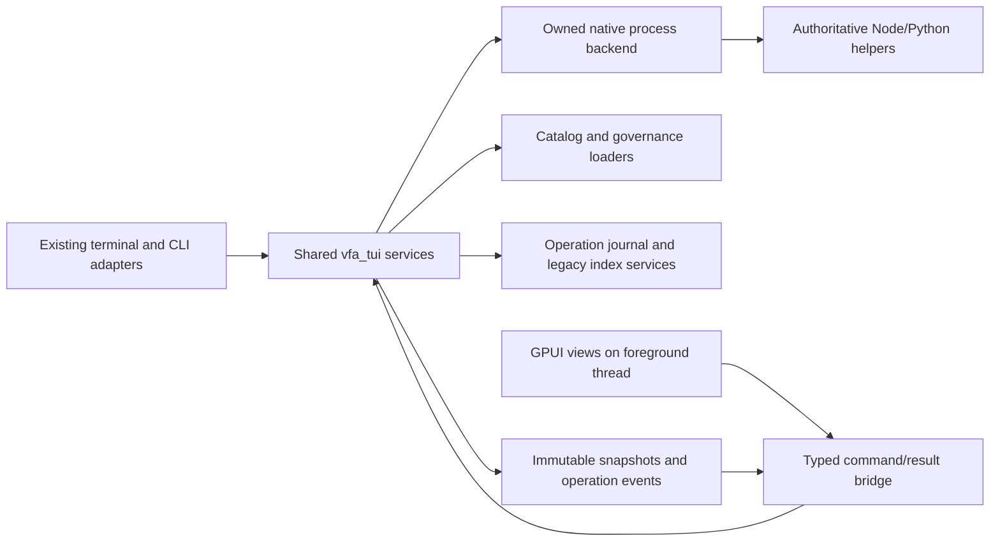

# Design Document: GPUI Desktop

## Overview

Status: REVIEW FINDINGS ADDRESSED; AWAITING USER DESIGN APPROVAL. This document is
a technical proposal, not an implementation or proof of native compatibility.

The user explicitly approved the revised requirements and authorized design.
Approved requirements SHA-256:
`490b95ba21dcf9d6ec6ca803586afd785f1803287c38f0193bed053701e31160`.
Those bytes are frozen; their earlier review-status prose predates the approval
record in the workflow state. Design approval and task breakdown are separate
future gates. All requirements, including native Windows and populated governance
workflows, remain in scope. No application files are changed in this phase.

Use the existing `vfa-tui` library as the shared engine in a presentation-free
build, and add `tools/vfa-desktop/` as a native GPUI application. Existing scripts
remain authoritative. Do not introduce a server, RPC transport, browser shell,
separately published engine crate, cloud connector or additional business-rule
implementation.

### Research and evidence

- Baseline source and limitations: [research.md](research.md). Important additional
  seams: `headless/reporter.rs:33,115` consumes `Cli`, which imports UI theme types
  (`cli.rs:25`); report serialization actually uses a `data` envelope and caller
  package version (`headless/reporter.rs:475–487`). Both must survive separation.
- Selected toolkit candidate: `gpui-kit = "=0.9.1"`, release commit
  [`39ab849a93b5f15507b969164d49891db8d5b470`](https://github.com/longbridge/gpui-kit/commit/39ab849a93b5f15507b969164d49891db8d5b470).
  The [release manifest](https://github.com/longbridge/gpui-kit/blob/39ab849a93b5f15507b969164d49891db8d5b470/crates/kit/Cargo.toml)
  declares `component`, `assets` defaults and separate `test-support`. Matching
  GPUI snapshots are `0.3.12`; optional GPUI Fast is not selected.
- Context7 and primary [task](https://gpui-kit.com/docs/task/) and
  [testing](https://gpui-kit.com/docs/test/) guides corroborate foreground entity
  ownership and interaction-test boundaries. Indexed/mutable documentation must
  not override the selected source revision. Its crate archive checksum remains
  unverified until registry resolution and lockfile capture.
- Tokio documentation retrieved through Context7 warns that started
  [`spawn_blocking` tasks cannot be aborted](https://docs.rs/tokio/latest/tokio/task/fn.spawn_blocking.html).
  Moving a blocking operation off the UI thread is not a cancellation strategy.

GPUI/Tokio integration, native process ownership, packaging and throughput below
are architectural decisions that require prototypes. Upstream CI is not evidence
that this repository's application passes them.

## Architecture

### D1: Package boundary and compatibility

Keep the existing published crate name, location, default behavior and release
ownership. Add default feature `terminal` to `tools/vfa-tui/Cargo.toml`:

- `terminal` enables optional ratatui, crossterm, terminal-light, clap and
  adapter-owned logging dependencies. `[[bin]]` requires `terminal`.
- Gate `app`, `ui`, `cli`, CLI-dependent report wrappers and tracing initialization
  behind that feature. Do not gate domain services or hide their tests to pass.
- A no-default-feature library exposes models, errors, catalog/search, federation,
  policy, security, workspace, gates, subprocess, persistence and pure report
  services. It contains no GPUI or terminal presentation types/dependencies.
- Preserve existing public module paths and error variants where possible. Keep
  the existing `TuiError` name rather than create an unnecessary rename migration.
  A terminal-related string error variant is not a dependency on terminal types.
- Split `HeadlessReporter` orchestration into transport-neutral `ReportRequest`
  and `ReportService`; retain its `Cli`-taking wrapper on default builds. Pass
  producer name/version explicitly so the legacy report producer stays `vfa-tui`.
- Do not change the root into a Cargo workspace. Retain the current TUI lockfile;
  Desktop has its own committed lockfile and `publish = false`. Its path dependency
  selects `vfa-tui` with `default-features = false`. Verify shared code under both
  resolved graphs; two lockfiles are deliberate isolation, not proof of parity.

Proposed Desktop dependencies, not files already written:

```toml
[dependencies]
gpui-kit = { version = "=0.9.1", default-features = false, features = ["component", "assets"] }
vfa-tui = { path = "../vfa-tui", default-features = false }

[dev-dependencies]
gpui-kit = { version = "=0.9.1", default-features = false, features = ["component", "assets", "test-support"] }
```

Do not add standalone GPUI snapshots, Fast, shell, WebView, speech, profiler or
language-server/editor packages. Keep the consumer's test-support feature out of
normal release builds. Existing release-plz and TUI package publication still
operate on one published crate; no engine dependency must be published first.
Package assembly, semver and dependency-closure checks remain required.

### D2: Data flow and ownership



Existing module APIs remain the implementation of catalog, ranking, coverage,
drift, policy, dependency graphs and integrity. Add a thin `engine` module for
session/context coordination and typed operations, not a parallel domain model.
TUI/headless compatibility adapters call these same services; only presentation,
CLI serialization and the caller's existing persistence policy differ.

The session owns the active Catalog Checkout identity, source epoch, catalog
snapshot, trust grants, previews and operations. A context uses canonical path
plus native filesystem identity, not path text alone. Persist paths, never trust
grants or confirmation tokens. On startup validate the saved source without
executing it; invalid sources lead to the picker, not an implicit CWD fallback.

`CatalogStore::load/reload_file` remains authoritative. Publish immutable,
reference-counted snapshots after background loading; rebuild changed data/index
once per content revision, not on every paint. Data revisions advance on changed
content; a separate event sequence covers freshness/errors without pretending
unchanged bytes became a new content generation. Manual refresh and watcher
events use one reload path; deletion/read failure marks last-good data stale.

Search results carry checkout/source epoch, content revision and query request
sequence. Only a matching latest result can update the visible collection.
Selection is `(entity_kind, stable_id)`, never list index. Agent search delegates
to existing matching/filter intersection. Other entity searches share search
module implementations over ID/name/summary; ties use stable case-insensitive ID
then exact ID. Empty/no-match/Unicode behavior follows the approved requirements.

Source switching is rejected while any operation is queued, running or cancelling.
Otherwise it clears selections, previews and trust before loading a new context.
Obsolete data events may be discarded from the active view; operation/audit
events remain attached to their original context and are never silently dropped.

## Components and Interfaces

### D3: GPUI to Tokio runtime bridge

The GPUI application owns the native main thread and view entities. A dedicated
service host thread owns a long-lived multithread Tokio runtime with its I/O/time
drivers enabled. Existing asynchronous subprocess/persistence tasks start only
inside that runtime. The application receives a lightweight `EngineClient`; no
Tokio runtime is created per click and none is dropped in a GPUI callback.

Proposed API sketch; names are design interfaces, not currently compiled symbols:

```rust
struct EngineClient { /* bounded command sender; event subscriptions */ }
enum EngineCommand {
    SelectCheckout(CheckoutRequest), Search(SearchRequest), Refresh(ContextId),
    Scan(ScanRequest), VerifyIntegrity(ContextId), RunGate(GateRequest),
    PrepareExport(ExportRequest), ConfirmExport(PreviewId), Cancel(OperationId),
    ChangeRegistry(ConfirmedRegistryChange), BuildReport(ReportRequest),
    ExportReport(ConfirmedReportDestination), Shutdown(ShutdownChoice),
}
struct RequestTag { context: ContextId, data_revision: u64, request_seq: u64 }
```

Client submission is nonblocking and reports `BUSY` for a full normal-command
queue. Cancellation/shutdown has an independent control path so output/search
traffic cannot starve it. Run at most one target-mutating job per session; scans
and searches use bounded workers. Coalesce obsolete searches, never confirmations
or terminal events. Completed state lives in the engine/journal; a UI subscription
can resynchronize after a dropped frame rather than require an unbounded event log.

GPUI foreground tasks await runtime-neutral result/channel futures and apply
owned results to a weak view handle on the foreground. Keep subscription/task
handles in application state until explicit shutdown; no detached view mutations.
Parsing, hashing, scanning, formatting and SQLite calls stay off render/input.

Blocking scans check cooperative cancellation between files/workspaces. SQLite
work uses its owning worker with bounded busy wait and explicit interruption
where supported. A started blocking call is not deemed stopped because its future
was dropped. Closing with jobs offers Wait or Cancel; reaping/terminal evidence
and writer drain finish before the service runtime is joined off the UI thread.
Only after a shutdown acknowledgment does the window exit. A crash leaves pending
journal operations interrupted on restart, never replayed.

### D4: Native desktop presentation

Start with Kit's documented application/assets initialization and Root-wrapped
window entry point; verify exact imports on the pinned release during the first
compile probe. Root owns overlay/dialog/focus facilities. Application state is a
view model over engine snapshots, not `vfa_tui::App` or terminal widget state.

| View | Content and operations | Interaction contract |
| --- | --- | --- |
| Checkout picker/context bar | Selected canonical checkout, validity, freshness | Mouse/keyboard picker or editable path; never auto-trust |
| Catalog | Agents, skills, roles, providers, MCP references, rules; shared filters and details | Virtualized list/table, stable row IDs, editable no-match state, optional fields labeled unavailable |
| Relationships/integrity | Edges, missing references/cycles, verified/missing/mismatched assets | Selectable accessible lists/detail panels; no requirement for a bespoke graphical graph canvas |
| Workspaces/governance | Registry controls, coverage, drift, policy findings and input status | Real computed data, per-workspace provenance, explicit partial/not-configured states |
| Validation/jobs | Approved gates, full validation, redacted output, cancellation and terminal evidence | Run confirmation after trust, keyboard-accessible output/tail controls; no fake success |
| Export | Selection, platform, destination, authoritative plan/conflicts, confirmation | No default-confirm action; stale preview disabled; partial effects remain visible |
| Audit/reports/preferences | Persisted operation history, existing report projections, local theme/path settings | Confirm file writes/overwrites; system/light/dark, remembered non-secret preferences |

Use standard release-supported Kit controls instead of interactive custom `div`
widgets. Register stable IDs and accessible names explicitly; labels near inputs
are not assumed associations. Use action/key bindings for Enter/Escape/Tab and
platform primary modifiers, not injected text. Return focus to the invoking
control after a modal; a global quit key must not silently bypass active jobs.

Layouts scroll/reflow at 200% text/UI scale and 1280×800 logical pixels. Focus and
error/status meaning are visible without color alone. Standard native text
editing must preserve Unicode and composition; test OS IME/clipboard separately
from headless input simulation. Default appearance tracks the OS, with a persisted
override. No remote images, active catalog HTML, automatic links or embedded
WebView: ordinary catalog text remains inert and assets are bundled locally.

Selected-facility matrix for Kit `0.9.1` / GPUI snapshot `0.3.12`:

| Facility / selected release evidence | Linux X11 | Linux Wayland | macOS ARM64 | Windows x64 | Acceptance distinction |
| --- | --- | --- | --- | --- | --- |
| Native application/Root, `component` + `assets` in pinned Kit manifest | UNVERIFIED app | UNVERIFIED app | UNVERIFIED app | UNVERIFIED app | Compile bootstrap and real-window launch in V8/V10; manifest features alone prove no runtime behavior |
| Standard input/select/button and list/table controls; release-labeled component/testing guides | UNVERIFIED | UNVERIFIED | UNVERIFIED | UNVERIFIED | Verify chosen component API, virtualization, keyboard and application effects in V8; no framework-level support inference |
| Dialog/focus/appearance facilities; release-labeled accessibility/testing guides | UNVERIFIED | UNVERIFIED | UNVERIFIED | UNVERIFIED | V8 tests modal scope/restoration, AT and 200% scaling in real windows |
| Kit `test-support` interaction harness, explicitly declared by pinned manifest | UNVERIFIED local | UNVERIFIED local | UNVERIFIED local | UNVERIFIED local | In-process event/state assertions, not packaged launch, native AT or pixels |
| Offscreen pixel renderer; live `0.3.12` testing guide | Documented WGPU; UNVERIFIED local | Documented WGPU; UNVERIFIED local | Documented Metal; UNVERIFIED local | Documented unavailable | Explicit renderer target plus native visual evidence; Windows skip is not PASS |
| Native AT/IME/clipboard and application shutdown | UNVERIFIED | UNVERIFIED | UNVERIFIED | UNVERIFIED | Separate native tests; headless input metadata is not this evidence |
| Embedded WebView / GPUI Fast / JS shell | NOT SELECTED | NOT SELECTED | NOT SELECTED | NOT SELECTED | WebView's documented X11/XWayland limitation does not constrain the chosen no-WebView UI |

This is the current release-specific evidence/status record, not a certified
support matrix. Source-labeled guides must be reconciled with the pinned commit
during V10; unavailable source/API verification remains UNVERIFIED. Populate
actual component/test outcomes per backend rather than replace these cells with
the general “cross-platform” statement from upstream.

### D5: Execution provenance, trust and launch plans

Only typed requests reach execution. Resolve helper paths and read metadata
without spawning on browse. Missing helper information does not block catalog
use. A user-requested Preview/Run initiates trust/preflight; even version probes
are helper execution, not a hidden browse-time check.

For known operations build an `ExecutionManifest` over canonical checkout/native
identity, package.json and lockfile bytes, invoked script and recursively loaded
local code/config dependencies, and resolved runtime executable identities. For
validation include the package pipeline and every invoked validation/generator
script/config; for export include the exporter and modules/data it reads. Record
the inventoried path/hash list, not only a digest. Do not infer dependencies by
executing untrusted code. If a complete inventory cannot be established (dynamic
imports, external command configuration, mutable installed dependencies), mark
it incomplete and require execution-specific trust with that uncertainty; never
reuse it as a complete revision grant. Revalidate before every helper launch.

The session grant is for this manifest revision and disclosed operation effects,
not all future code at the same path. Changed identity or content invalidates it.
The trust dialog states that trusted helpers have the user's ordinary local
permissions, may write/read outside the GUI's display context and may use network
as disclosed. This is not a sandbox. No elevation, credentials, downloads or cloud
mutation is introduced by the application.

`ProgramSpec` uses a resolved executable plus `OsString` arguments, cwd and an
allowlisted/redacted environment. Validate identifiers/options separately from
native paths; Windows separators are not shell injection. Preserve native path
identity; reject unrepresentable JSON paths explicitly rather than lossy conversion.
Retain existing secret-variable filtering/redaction and sanitize control sequences
before presentation/persistence. This is pattern-based protection, not full DLP.

For all OSes launch installed Node plus an explicitly resolved `npm-cli.js` to run
an approved package script; do not construct `cmd /c`, PowerShell or shell strings
from UI/catalog text. Keep `npm run validate` pipeline order/semantics rather than
replacing it with an inferred parallel DAG. Trusted npm scripts may themselves
use their configured shell: disclose that execution, do not claim it is sandboxed.
Resolve/check `python3` required by this repository's scripts on Windows as a
separate prerequisite; do not silently rewrite script commands or install an alias.
If Node/npm CLI/Python cannot be resolved, present corrective settings/install
instructions without downloading anything. Explicit custom gate execution still
uses existing gate definitions, dependency rules and failure propagation.

### D6: Authoritative exporter plan and result contract

Extend `scripts/export-marketplace-agents.mjs` backward-compatibly. Existing flags,
textual dry-run and normal export behavior remain supported. One Node planning
function computes selection, destination mapping, companion skills and collisions;
both legacy execution and new planning/apply modes consume it. Rust never
recomputes export policy or path destinations.

Proposed additional modes: `--plan-json` and `--apply-plan <file>`. Their versioned
protocol is `vfa-export/1`. Precise flags/schema become a tested script contract,
not guessed stable upstream APIs. The plan includes source identity/manifest,
selection/platform/options, canonical destination, per-file source hashes,
destination identity/existence/hash expectations, create/overwrite/skip action,
transformation identity/options, expected final-content hashes, conflict reasons
and a digest over Node's defined canonical serialization.
Plans with unknown/invalid effects cannot be confirmed. Existing destination
without force is explicitly skipped or rejected according to the same exporter
rules, never represented as a write that did not occur.

Source bytes are not always final bytes: Codex currently rewrites skill paths
after copying (`scripts/export-marketplace-agents.mjs:432–442,665–668`). Extract a
single authoritative Node artifact renderer used by planning, apply and legacy
modes. It binds destination-dependent transformations and expected final bytes,
including encoding/newline/permission behavior, without a second Rust renderer.
Apply derives/verifies final bytes before writing them, avoiding an intermediate
unrewritten Codex file. V5 compares destination-dependent final content, not just
source-file hashes.

Prepare sequence:

1. User asks Preview; establish current execution trust and acknowledged audit
   start record before launching the dry-run helper.
2. Parse a bounded, versioned plan; validate source/context, all relative-path
   containment, canonical/native identities and protocol fields. A valid dry-run
   does not authorize apply. It performs no target writes, including lock files.
3. Show actual plan, conflicts, force/no-skills behavior and residual concurrency
   limits. Store plan/digest in app-private storage; mint a single-use preview ID.
4. Confirmation atomically consumes that preview ID; recheck current source,
   freshness, execution manifest, target parent chain and fingerprints. A changed
   request is rejected, never silently replanned then executed under old approval.
5. Commit the confirmation/start event and invoke apply exactly once for its
   operation ID. Node verifies plan schema/digest and recomputes the authoritative
   current plan before the first write; mismatch rejects without writing.

Before each file write Node verifies relevant source/destination state, uses the
verified final rendered bytes, and stops on detected changes. Apply emits ordered file
outcomes and a final summary as bounded JSON lines; unstructured diagnostics use
redacted stderr. The engine verifies paths/counts/terminal summary against the
approved plan and child exit status. Exit zero without a complete valid summary
is protocol failure, not verified full success. Oversized plan/result payloads
produce an explicit `PLAN_LIMIT`/`PROTOCOL_LIMIT` error, never truncation-as-success.

Protocol stdout is not lossy display text. The engine incrementally parses bounded
raw records before display dropping, control sanitization or redaction can alter
them. Validate version/sequence/paths/digests and retain observed effects in the
operation state/journal independently of the UI tail. Only derived display/audit
projections are redacted; protocol fields used for plan validation remain intact
inside the engine. Parser/framing buffers count toward the same 8 MiB raw-output
budget. On protocol overflow, loss or an evidence-path failure, stop the export,
continue safe draining/cleanup and report partial/unknown effects, retaining every
already validated outcome. Never continue writing while quietly discarding
authoritative outcome records or parse a truncated display tail as protocol.

No multi-file atomicity is promised. If cancelled, timed out, interrupted or
failed after any writes, show known completed paths and an explicit uncertain
remainder. An absent file outcome cannot prove no write occurred. No automatic
retry, deletion of existing target content or rollback. Any safe cleanup is limited
to that operation's own uncommitted temporary files; uncertain remnants are shown.
Preflight/per-write checks do not prevent a
malicious same-user actor racing filesystem changes; operators must not edit
inputs/targets concurrently under the approved concurrency boundary.

### D7: Native jobs, process ownership and output bounds

`ProcessBackend` accepts `ProgramSpec`, timeout and operation ID; it exposes
separate bounded output, reliable status and cancellation paths. `OperationRecord`
owns all native handles until cleanup is observed. Exactly one terminal execution
outcome is selected by an engine state transition; exit/cancel/timeout races
cannot each produce a terminal record. Once terminal, later notifications update
cleanup/evidence diagnostics, not a second outcome. Child exit alone is not tree
cleanup; cleanup failures are errors, not successful cancellation.

| Backend | Ownership and cleanup design | Required feasibility probe |
| --- | --- | --- |
| Linux/macOS | Reuse Tokio spawning with an owned process group; TERM, bounded grace, then KILL; wait for root and observe remaining owned descendants. Never signal an unrelated reused PID | Parent/child/grandchild, root-exits-first, repeated cancel, timeout, detached-descendant/cleanup-failure detection; no required cleanup assertion may be silently skipped |
| Windows | Native backend owns a kill-on-close Job Object with breakaway disabled and process/pipe handles. Use a create-in-job facility where available, otherwise suspended-create/assign/resume with failure cleanup. Do not assume direct-child kill or a plain Tokio Child covers descendants | Required native MSVC probe under normal and inherited job contexts, assignment failure, root-exits-first, Unicode argv, process creation crash window and handle/pipe cleanup |

Windows design is grounded in Microsoft's
[Job Object documentation](https://learn.microsoft.com/en-us/windows/win32/procthread/job-objects).
An OS-specific launcher may use native handles and dedicated I/O workers rather
than pretending it can manufacture a Tokio Child from unsupported raw handles.
Verify API/binding versions before implementation. A backend unable to meet
R9.3/R14.4 blocks target acceptance; feature disablement or WSL is not a substitute.
Unix process groups are not containment against deliberately escaping helpers;
the detached-descendant probe must establish the supported helper contract or
identify the missing process-ownership mechanism before the target can pass.

Read both pipes continuously in fixed-size byte chunks, never `lines()` with an
unbounded partial line. Enforce one per-job 8 MiB raw-output budget across reader
buffers, queued chunks and display tail. Reserve room for both streams; truncate
individual display records at a UTF-8 boundary, emit dropped-byte/line counters,
and continue draining when the UI is slow. Protocol parsing precedes this display
path as specified in D6. Redaction uses bounded recognizer state, not merely a
fixed overlapping text window: recognized PEM/key spans suppress content until
their ending delimiter, including across lines, arbitrarily long spans, EOF or
cancellation. Finite patterns retain only bounded unresolved prefixes; oversized
ambiguous candidates are conservatively suppressed/truncated with a marker until
a delimiter rather than emit possible credential bytes to stay under the cap.
Do not buffer an entire secret awaiting its closing marker. Tests include secrets
longer than the carry size, multiline/unterminated PEM and boundary-split tokens.
Persist bounded redacted excerpts, not an unbounded raw log. Terminal/status
events never share a lossy output queue. UI rendering processes bounded batches
per frame, preserving cancellation/navigation latency under output pressure.

### D8: Operation evidence and safe persistence

Preserve existing legacy index/audit schemas, paths and report side effects for
the TUI/headless compatibility adapter. Do not silently migrate, import, reset or
prune existing user databases just to launch Desktop. Desktop has its own per-user
profile and a new `operations.sqlite` journal; existing catalog/index services can
use a separate Desktop-local legacy-format index. Both are shared engine services,
not GUI calculations. An explicit user-supplied legacy path is not permission to
replace it with the new journal schema.

Use OS per-user configuration/data APIs (XDG on Linux, Application Support on
macOS, appropriate AppData locations on Windows). No `HOME`/`/tmp` fallback when a
private data root cannot be established. Browse remains available without the
journal; helper execution/writes are disabled until required audit access works.

Before recovery, opening a writer or updating profile/preferences, acquire an
OS-backed exclusive owner lock for the canonical Desktop profile. Keep its handle
for the entire session; a PID file is not ownership proof. A second instance
cannot recover/mark interrupted jobs owned by the live first instance: it reports
the busy profile and remains browse/read-only or selects another explicit profile.
Only after exclusive ownership is established and the former owner's OS lock is
released may startup classify that profile's persisted nonterminal records as
interrupted. Events record the owning session ID. All new journal writers honor
this lock; it is not protection against a malicious same-user database editor.
Do not unlink/recreate an active lock file and accidentally create two owners.

The new `OperationJournal` uses an application/schema identity distinct from the
legacy v4 index and forward-only, transactional migrations. Proposed initial data:

| Table | Key / content | Invariant |
| --- | --- | --- |
| journal_meta | Application ID, schema version, producer | Refuse foreign/newer schema; never reset data |
| operations | Unique operation ID, kind, source/destination identity, manifest/preview digest, current projection | One action instance; no restart replay |
| operation_events | Unique `(operation_id, sequence)`, event kind, observed time, bounded redacted payload | Retry-idempotent evidence; append order established by writer |

The single writer owns its SQLite connection on a dedicated worker. A mutation
reply contains `Result<CommitReceipt, JournalError>` and is sent only after SQL
execution and COMMIT succeed. Enqueue/Flush is not durable acknowledgment. Begin
execution only after the start/confirmation event is committed. Use a transaction
for event insert and projection update; duplicate sequence with different payload
is a conflict, not a successful retry. Do not reuse the legacy writer's ignored
SQL-result behavior. Existing legacy chain data is preserved; no new immutable or
tamper-proof claim is made about either store.

Observed execution outcome and evidence status are independent. If a terminal
commit fails after a known child success, UI shows `SUCCEEDED` plus audit `FAILED`
and evidence-incomplete warning, not `INTERRUPTED`. Block new helper executions/
writes; allow browsing, cleanup and evidence recovery. Keep pending events for
currently admitted jobs bounded; retry only those event writes with the same IDs.
Permanent foreign-schema/invalid-data errors require operator correction, not a
retry loop. If the app dies before pending terminal evidence is saved, next
startup classifies persisted nonterminal operations interrupted/unknown-effects;
it cannot reconstruct an unrecorded success or re-execute the action.

Registry/preferences/report writes use explicit confirmations as required, safe
write-to-temp/rename where appropriate, and operation evidence. Report-file and
audit-file destinations include overwrite behavior. No retention/deletion policy
or destructive migration is introduced. Query APIs return errors/status rather
than silently convert a locked/corrupt store into an empty healthy result.

### D9: Governance and report services

Reuse registry/scanner, CoverageEngine, drift detection, PolicyEngine, dependency
graph and integrity implementations. Each result carries workspace/source/input
provenance, scan revision and per-input status. Unregistered registry is
`NOT_CONFIGURED`; missing policy configuration is likewise `NOT_CONFIGURED` for
policy only; invalid/unreadable policy is `UNAVAILABLE`. Neither is zero violations.
Successful empty findings remain `CURRENT` with an empty result, not a failed load.

Mixed-success aggregation is explicitly `PARTIAL`, with expected/successful input
counts and every exclusion reason. Scores apply only to their named successful
subset; do not display a complete-health score over missing inputs. Catalog,
workspace or policy changes invalidate dependent governance snapshots. Last-good
data stays visible as `STALE`, with original provenance, until recomputed. No
coverage, violations, audit or settings view is backed by placeholder collections.

`ReportRequest` contains report type/format, explicit registry/policy/index paths,
workspace selection and caller producer identity. `ReportService` returns owned
report data and quality/provenance, without printing, reading Cli or installing a
global tracing subscriber. The legacy wrapper preserves actual executable JSON
`data` envelopes, stdout/stderr, flags, producer version, exit codes and documented
persistence side effects. Desktop renders the same report calculations with
quality annotations. Its new export envelope is explicitly versioned and distinct
from existing CLI output; it wraps the existing report payload plus status and
provenance, never silently changes the legacy machine-readable schema.

## Data Models

### D10: Typed contracts and state transitions

Reuse existing serde models and strict unknown-field behavior. New DTOs are
engine-owned, with no GPUI entities, terminal geometry, Cli or UI theme objects.
Sketch of additional contracts:

```rust
struct ContextId { checkout: CheckoutIdentity, epoch: u64 }
struct Snapshot<T> { context: ContextId, revision: u64, data: T, quality: Quality }
struct Quality { status: DataStatus, observed_at: String, issues: Vec<InputIssue> }
struct ExportPreview { id: PreviewId, plan_digest: String, context: ContextId }
struct OperationRecord {
    id: OperationId, context: ContextId, state: OperationState,
    evidence: AuditPersistenceStatus, effects: EffectsKnowledge,
}
enum EffectsKnowledge { NoneVerified, KnownPaths(Vec<Effect>), PotentiallyPartial }
```

- `LOADING`, `CURRENT`, `EMPTY`, `PARTIAL`, `STALE`, `UNAVAILABLE`,
  `NOT_CONFIGURED` are data states, never process outcomes. A result also records
  source hashes and input issues; clocks describe observations, not cache validity.
- Operations progress `QUEUED → RUNNING → [CANCELLING] → terminal`. Preflight or
  audit rejection may fail from queued without spawning. Cancellation requested
  before child launch means no launch. The controller serializes competing events.
- Terminal outcomes are exactly those in requirements. An already observed exit
  outcome wins over a late cancel request; cancellation/timeout is only confirmed
  after cleanup. Unobserved completion on restart is interrupted.
- Preview IDs/confirmations are session-local, single use and not rehydrated after
  restart. An operation ID persists; duplicate delivery cannot start another child.
- Unknown required fields, wrong protocol versions, invalid path encodings,
  duplicate entity IDs or stale identity are named errors; never normalize them
  into current empty data. All catalog totals/options come from active data.

## Error Handling

### D11: Failure, recovery and user-visible evidence

| Error class | Visible result | Recovery / forbidden behavior |
| --- | --- | --- |
| Invalid/missing checkout or catalog collection | Picker or per-collection unavailable; valid independent collections usable | Explicit reselect/refresh; no source code execution |
| Reload/scan/policy failure | Stale last-good or unavailable input; aggregate partial | Correct input then refresh; never healthy zero fallback |
| Runtime/helper missing, untrusted or manifest changed | Action blocked with specific prerequisite/trust context | User configures installed runtime or grants current trust; no install/elevation |
| Preview/protocol/path/fingerprint conflict | Confirmation disabled or apply rejected; source/destination shown | New preview/confirmation; no implicit replanning under old permit |
| Cancel/timeout/child nonzero/cleanup failure | Actual terminal outcome, exit/cleanup diagnostics and partial/unknown effects | No automatic target retry or rollback; cleanup failure blocks target acceptance |
| Output loss | Explicit bounded-loss counter, unaffected exit evidence | Continue drain; never pretend tail is the complete output |
| Journal start failure | No child or write; browsing remains available | Correct store; successful commit receipt required to retry a new action |
| Journal terminal failure | Known execution result plus failed evidence status | Retry evidence only with same IDs; no action replay |
| Foreign/newer/corrupt DB | Store unavailable with preservation warning | Refuse reset/downgrade; backup/forward plan requires separate review |
| Native renderer/platform unsupported | Actionable startup diagnostic or matrix failure | No compile-only/WSL/skip substituted for native support |

Known credential patterns are redacted from errors and audit payloads too. Do not
turn generic I/O failures into misleading LogDestination/catalog errors. Adapters
translate engine errors into existing legacy behavior where required; corrections
have paired legacy/new regression cases, not silent compatibility exceptions.

## Testing Strategy

### D12: Observable acceptance and regression gates

Tests below are planned files/commands, NOT files already implemented or passing.
The current phase executes only spec graders, source checks and repository gates.
Fixtures must be present or tests fail; no early-return fixture skips. Golden
expectations come from reviewed fixed inputs/baseline executions, not production
code computing its own expected values. Native evidence records source/lockfile
hashes, OS/backend, toolchain, hardware and actual results.

#### V1: Presentation-free engine and package compatibility

Add `tools/vfa-tui/tests/core_contracts.rs`; build/test library without default
features and inspect normal dependency closure for terminal/GPUI packages.
Compile existing public import paths and legacy/default tests. Run
`cargo check --manifest-path tools/vfa-tui/Cargo.toml --no-default-features --lib --locked`
and corresponding core-contract tests; run default fmt/clippy/test and package
assembly checks. Desktop's locked dependency graph receives its own check. Cargo
tree is evidence of dependency resolution, not runtime non-execution proof.

#### V2: Existing CLI/headless contract preservation

Extend existing headless integration fixtures to assert actual `data` envelope,
flags, producer identity, exit codes/stdout/stderr and persistence behavior.
Normalize only declared volatile observation fields in reviewed golden fixtures.
Core request service and CLI wrapper must return the same fixture calculation.
Do not use the unused report struct as the baseline schema.

#### V3: Catalog, search, context and reload

Core-contract fixtures check every entity/detail, optional metadata, intersection
filters, Unicode/ties, empty/no-match, stable selection and invalid reload retaining
last-good data. Queue old-query/source events deliberately; verify stale display
events are rejected while terminal/audit events remain retained. Exercise all
nonterminal source-switch cases, not only running.

#### V4: Real governance, relationships and reports

Two managed-workspace fixtures provide known installed/missing/changed assets,
dependency cycles, hash mismatch and policy violations. Assert populated views
and exact per-workspace results; mix an unreadable workspace and invalid/absent
policy. Verify partial denominators/provenance and stale propagation. Report data
matches engine results rather than just a nonempty rendered widget.

#### V5: Export plan/apply compatibility and effects

Node fixtures exercise both unchanged legacy modes and `vfa-export/1`, including
companion skills, platform mapping, collisions, force/skip, source/target changes,
symlink replacement detected preflight, malformed/oversized plans, duplicate
confirmation and cancellation after first write. Snapshot target trees before and
after preview to assert zero target writes. Apply assertions compare exact
per-file contents/effects with the authoritative plan. Missing summary/exit-zero
and partial-effect uncertainty must fail verified-success assertions.
Cover Codex destination-dependent transforms and final-content hashes; interrupt
before/after final-byte publication. A slow UI must not lose protocol effects:
parsed outcomes survive display-tail loss, while protocol overflow stops apply
with partial/unknown effects rather than successful truncation.

#### V6: Runtime/process/output lifecycle

Use a portable Rust helper under `tools/vfa-tui/tests/support/` for descendants,
controlled exit, stdout/stderr pressure, long no-newline output and handle cleanup.
Drive services through the actual GPUI bridge, not just isolated Tokio unit tests.
Record root and descendant exit acknowledgments; verify timeout/cancel races,
root-exits-first and platform cleanup failures. Run the 64 MiB unterminated-stream
case before newline, measuring all raw buffers against the 8 MiB limit, including
slow/disconnected UI and redaction patterns split across chunks. No `abort()`-only
assertion proves a blocking scan/SQLite worker has stopped.
Test long recognized secrets exceeding the recognizer carry size, multiline PEM,
missing closing delimiter, EOF and cancellation without disclosing buffered bytes.

#### V7: Journal acknowledgments and data preservation

Tests force SQL/commit failure before launch (zero action calls), after observed
success (`SUCCEEDED` plus audit `FAILED`), and recovery (same evidence written
once, action never replayed). Test duplicate IDs/conflicting payloads, pending-job
restart, disk/lock/schema failures and unknown-effect reporting. Hash legacy v4
database fixtures before/after opening Desktop: they must remain unchanged. Test
new-journal forward migrations transactionally and refuse foreign/newer schemas.
Run a two-process same-profile test: second instance neither mutates the journal
nor marks the first instance's running jobs interrupted; after owner death only
the new exclusive owner performs recovery. Test lock release after crashes too.

#### V8: Native UI, accessibility and interaction semantics

Proposed `tools/vfa-desktop/tests/ui.rs` uses same-version Kit test-support, stable
IDs, real pointer/key events and actual application outcomes. A disconnected
callback with unchanged metadata must fail. Headless focus/layout/accessibility
assertions supplement, never replace, native visual/AT/IME/clipboard checks.
Real-window native smoke runs on Linux X11 and Wayland, macOS Apple Silicon and
Windows x86_64 MSVC. AT checks use the platform's actual screen reader (for
example Orca, VoiceOver and NVDA), recording versions and announcement/focus/action
results. Verify 200% scale, themes, modal focus and all approved keyboard flows.

#### V9: Fixed performance protocol

Implement the exact approved 10,000-entity corpus, query distribution/pacing,
scan/output pressure, raw samples and nearest-rank percentiles. No shorter fixture,
excluded slow samples or synthetic “visible=true” timing. Verify pressure overlap,
5-second startup, 250-ms search, 100-ms navigation and 10-second cleanup budgets
on recorded reference configurations for every required target. Missing evidence
is unverified/incomplete, not extrapolated from Linux.

#### V10: Native packaging and release provenance

Capture selected crate/source checksums and both lockfiles; compile the exact Kit
bootstrap and its test imports before UI construction. Match release-specific
component/test support. Explicit upstream rendering targets are not automatically
run by ordinary cargo test; Windows headless pixels may be unavailable, requiring
native visual evidence rather than a passed skip. Unpack artifacts on clean target
machines and launch from unrelated CWD against a selected checkout. Check assets,
licenses, notices, checksums and helper diagnostics. No signing/security bypass
or publication occurs without separate authorization.

#### V11: Trust, privacy and native path/runtime safety

Opening/browsing calls no helper/network/target writer. Changed manifest content
invalidates reusable trust before gate and preview execution. Injection-like IDs,
links, control sequences, environment credentials and quoted/Unicode/Windows
paths are fixtures; structured arguments retain intended identities. Run actual
native Node/npm/Python prerequisites on Windows. Unknown inventory requires
execution-specific trust, not a silent reusable path grant. Logs test documented
redaction limits, not an unsupported complete-secret-detection claim.

#### V12: Specification and regression suite

`python3 .kiro/specs/gpui-desktop/verify.py --design --self-test` checks approved
criteria coverage and references; removing a row/section must fail. It does not
prove architecture correctness. Independently refute the design, run
`npm run validate`, diff/scope/link checks and available spell/Markdown lint.
Implementation must additionally run all affected default/no-default Rust gates
and native acceptance suites. No criterion becomes PASS merely because its test
name or design section exists.

## Delivery and Migration

### D13: Incremental rollout without scope reduction

First verify the feature-gated library boundary, exact Kit bootstrap/test imports,
runtime bridge and native process ownership on the complete target matrix. These
are architecture feasibility gates before extensive UI construction, not a
smaller replacement product. If a required target fails, repair or explicitly
review an architecture change; do not delete the target/requirement to go green.

Then connect real catalog/navigation, governance/report services and the durable
job/export flow. Every completed slice retains its positive/negative regression
evidence; placeholder tabs and static mock data are not completed slices.

Keep existing TUI release workflows/package identity and no-GPU targets intact.
New desktop CI must watch both its paths and the shared `tools/vfa-tui/**` path,
plus exporter/script/schema inputs; shared changes must also exercise the consumer
graph. Proposed local commands before packaging include:

```sh
cargo fmt --manifest-path tools/vfa-tui/Cargo.toml --check
cargo clippy --manifest-path tools/vfa-tui/Cargo.toml --all-targets --locked -- -D warnings
cargo test --manifest-path tools/vfa-tui/Cargo.toml --locked
cargo test --manifest-path tools/vfa-tui/Cargo.toml --no-default-features --lib --locked
cargo fmt --manifest-path tools/vfa-desktop/Cargo.toml --check
cargo clippy --manifest-path tools/vfa-desktop/Cargo.toml --all-targets --locked -- -D warnings
cargo test --manifest-path tools/vfa-desktop/Cargo.toml --locked
```

The desktop manifest/tests do not yet exist. Native backends/rendering/AT and
package runs require additional explicit test targets/evidence, not this command
list alone. Verify the existing `cargo package`/publication-dry-run and semver
gates; no change to release-plz topology should be needed. Desktop-specific
license/source/target scanning must not weaken TUI deny policy globally.

Propose per-target private artifacts: relocatable Linux directory/tar with stated
system dependencies, macOS application bundle, Windows application directory/ZIP.
These are not app-store packages or proof of a complete installer. Preserve local
checkout-backed operation, expose missing helper prerequisites, and include
checksums and third-party notices/fonts/icons actually redistributed. Unsigned or
unnotarized status is explicit; no normal-path instruction disables OS security.
Public uploads, signing credentials, external CI actions and push remain separate
approval boundaries.

Toolkit source identity is verified; its archive checksum and final consumer
lock/toolchain floor are not. Use a pinned toolchain established by compiling the
locked graph on required targets; do not change the TUI's declared MSRV based only
on the Desktop toolkit's documented development floor. Do not assert either
manifest's Rust version has been tested until that test exists.

## Decisions and Alternatives

| Decision | Alternatives considered | Choice, reason and consequence |
| --- | --- | --- |
| Engine packaging | Separate published `vfa-core`; raw whole-TUI dependency; feature-gated existing library | Feature-gated library: smallest package/publication-compatible boundary, provided dependency/test guards prove no presentation leakage. Separate crate remains a reviewed fallback only if this boundary is disproven |
| Event/runtime model | Replace Tokio with GPUI executor; one runtime per action; persistent engine host | Persistent Tokio host plus typed foreground bridge preserves existing async services and explicit ownership; requires a real integration/shutdown probe |
| Persistence | Auto-migrate/share legacy DB; new GUI-owned calculations; isolated operation journal with shared legacy services | Separate Desktop journal/profile preserves existing user stores and compatibility. It deliberately does not import legacy audit history or change retention policy |
| Export planning | Derive paths in GUI; parse existing human dry-run; one authoritative Node plan/apply contract | Backward-compatible structured Node protocol provides real effects/conflicts without business-rule duplication; compatibility and race/partial-effect tests are mandatory |
| UI delivery | Browser/WebView shell; alternate toolkit; native GPUI Kit | Explicitly requested Kit with native controls, no WebView dependency that would complicate native Wayland acceptance; exact component APIs remain compile-verified gates |

## Requirement Traceability

Each range expands inclusively to the approved criterion IDs. Design anchors D1–D13
and verification groups V1–V12 are defined above; the structural grader rejects
unknown, duplicated or missing criterion coverage. This maps planned obligations,
not implemented functionality.

| Criteria | Design anchors | Verification groups |
| --- | --- | --- |
| R1.1-R1.6 | D2, D3, D4, D10 | V3, V8 |
| R2.1-R2.6 | D2, D4, D10 | V3, V8 |
| R3.1-R3.7 | D2, D4, D10 | V3, V8, V9 |
| R4.1-R4.6 | D2, D3, D6, D10 | V3, V5 |
| R5.1-R5.5 | D4, D9, D11 | V4, V8 |
| R6.1-R6.10 | D4, D8, D9, D11 | V4, V7, V8 |
| R7.1-R7.6 | D3, D5, D7, D8 | V6, V7, V11 |
| R8.1-R8.10 | D5, D6, D7, D8 | V5, V6, V7 |
| R9.1-R9.9 | D2, D3, D7, D8, D10 | V6, V7, V9 |
| R10.1-R10.11 | D8, D9, D10, D11 | V2, V7, V11 |
| R11.1-R11.6 | D1, D2, D9, D13 | V1, V2, V4 |
| R12.1-R12.6 | D1, D4, D5, D7, D13 | V1, V6, V8, V10, V11 |
| R13.1-R13.9 | D4, D11, D12 | V8, V9 |
| R14.1-R14.6 | D2, D3, D7, D12 | V6, V8, V9 |
| R15.1-R15.9 | D2, D4, D5, D6, D8 | V3, V5, V7, V11 |
| R16.1-R16.9 | D1, D12, D13 | V1, V2, V8, V10, V12 |

## Approval and Remaining Probes

Design review must challenge the feature-gated engine, report compatibility,
bounded bridge/job lifetime, authoritative export semantics, trust inventory and
durable evidence failures. High-severity contradictions must be repaired before
requesting approval. Native compilation, API imports, checksum/toolchain capture,
process-tree guarantees, AT/performance and clean-machine packaging are mandatory
implementation probes, all currently UNVERIFIED. Their absence is not converted
into a design-time runtime-success claim.

After independent review and structural/repository checks, obtain explicit user
design approval, then load `task-breakdown` and create dependency-ordered tasks
with exact owned files, acceptance commands and traceability. This document is
not permission to implement, publish, push or skip that phase.
